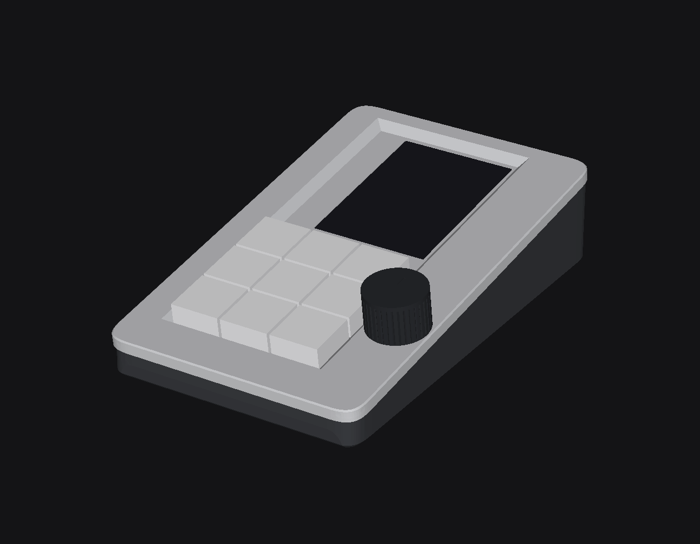

# macropad-obs

An OBS Studio control pad: a 3.5 inch display, a tall narrow strip display, 9 MX keys, 4 small
buttons and 3 push knobs on a flat milled slab. An ESP32-S3 joins Wi-Fi and is the obs-websocket 5
client itself; no PC process runs between the pad and OBS. A Linux Tauri app sets the pad up over
USB: OBS URL, SSID, secrets (write only), key mapping and display layout.

The contract is `docs/spec/spec-v2.md` with the owner's answers in `docs/spec/decisions-v2.md`. The
design as built is `docs/design.md`. The plan and task cards are `tasks/plan.md` and `tasks/todo.md`.



That picture is a mesh render of the style A case, cnc variant (`just cad render`); the keycaps are
envelope boxes. It is not a photograph. Nothing in it has been printed, assembled, or flashed.

## No hardware yet

No board, case or panel exists. Nothing has run on a chip. Every hardware number in this repo is a
datasheet value, an arithmetic result, or a MEASURE tag. What to buy, print, mill and assemble is
`docs/build-guide.md`. The bring-up order for the first board is `docs/bringup.md`.

## Commands

| Command | What it does |
| --- | --- |
| `just test` | gcc ASan/UBSan on `firmware/core`, cargo in `host/`, python3 checks, padsim end to end. No Docker, no window |
| `just padsim-smoke` | builds padsim (the core on the PC) and runs its smoke script |
| `just gate` | board-order gate: lists each open MEASURE on a gated `board.toml` entry; exits 1 while one is open. Not part of `just test` |
| `just firmware` | ESP-IDF v6.1.1 in Docker: builds the merged image `.build/esp32s3/macropad-obs-merged.bin` and checks the built partition table |
| `just flash` | writes that image over the ROM USB port with esptool in the IDF image. Needs the pad |
| `just pcb` | KiCad 9.0.9 in Docker: ERC, placement, critical copper, Freerouting, fab set, DRC. `just pcb step` exports the board STEP in KiCad 10.0.7-full |
| `just pcb-test-kicad` | the `pcb/gen` tests in the pinned KiCad image, where the pcbnew tests run |
| `just cad` | build123d in `cad/.venv`: case, exports with read-back, coupons, laser sheets, renders, fit against the board STEP |
| `just app` | `cargo build` of the Tauri app on the host. Needs `webkit2gtk-4.1` |
| `just app-check` | the same build in a Docker image made from the local `kicad/kicad:10.0.7`, then the window under Xvfb |

`cad/.venv` is local and gitignored. Create it with `uv` from `cad/pyproject.toml`.

## Status

Each row is a command run on this machine on 2026-11-20, with its real exit code. A gated command is
"not run: gated" and never counts as a pass.

| Command | Exit | What the run showed |
| --- | --- | --- |
| `just test` | 0 | `test-firmware`: 20 C test programs under ASan/UBSan. `test-host`: 135 cargo tests, clippy and fmt; padsim end to end for criteria 4, 4b, 4c, 5, 8, 9 and the app pages. `check`, `numbers` (13), `cad-check` (11) and `pcb-test` (218, 39 pcbnew tests skipped; they run in `just pcb-test-kicad`) |
| `just padsim-smoke` | 0 | a cut at program call 3, then the next start read the same NOR image |
| `just gate` | 1 | 18 open MEASURE tags on gated entries: no board order. Expected until the panels are calipered and the coupons printed |
| `just firmware` | 0 | image 1,040,608 bytes, DIRAM 93,058 bytes free; 5 partition rows match spec 10. Built only; never run on a chip |
| `just pcb-test-kicad` | 0 | 218 tests OK, 1 skipped, in `kicad/kicad:9.0.9` |
| `just pcb` | 0 | ERC clean; routed DRC at error severity: 0 violations, 0 unconnected, 0 parity, 4 copper layers; fab set byte-repeatable, 48 BOM findings listed. Provisional: J3 and J4 are `PLACEHOLDER_*` FPC footprints, so the set stays in ignored `pcb/.build/` |
| `just pcb step` | 0 | the STEP reads back 75 solids. Provisional, as above. Run it after `just pcb`: `just cad` fit exits 1 on a STEP older than the board |
| `just cad` | 0 | every step 0 problems; 42 case, 12 2D, 10 envelope, 3 laser, 12 B3F cap, 6 knob and 54 coupon files read back; FCStd not built (needs FreeCAD, not approved); fit: 0 interferences, DSA keycap seat not checked |
| `just app` | 0 | the Tauri shell and its 20 commands over `app_core` build on the host. The window was not opened here |
| `just app-check` | 0 | the same build in the image; the window showed under Xvfb within 10 s and was alive 5 s later. No look by eye (D6), no pad |
| `just flash` | not run: gated | no pad exists |

## Not built, not run, not proven

- **Not built:** the board (`just gate` exits 1), the printed case, the milled case, the FCStd, the
  committed fab set (task 5.12), the FPC footprints (task 5.3b), the dev kit spike firmware
  (task S.1).
- **Not run:** anything on an ESP32-S3, the panels, or a real OBS. The app pages (tasks 3.7, 3.8)
  ran only against padsim and under Xvfb: no real pad, no look by eye (D6), no real firmware
  update. No spike results (S.3), no dev kit acceptance (4.8), no bring-up (H.2), no JLCPCB or CNC
  quote (F.1, F.2).
- **Not proven without hardware:** Wi-Fi through the back-wall insert, reconnect times, input to
  scene change under 100 ms, strip update within 200 ms, redraw timing and SPI above 15 MHz, VBUS
  under 500 mA, the panel init tables, the ROM port after `BOOTLOADER`, no secret in the `nvs` and
  `cred` dumps or the UART log, case fit with no sanding. Each has a task card in `tasks/todo.md`
  (S.3, 4.8, H.2 to H.11).

VID `0x1209` PID `0x4F42` is not registered with pid.codes.

## udev

```text
sudo cp app/udev/70-macropad-obs.rules /etc/udev/rules.d/
sudo udevadm control --reload
sudo udevadm trigger
```

Two rules, both `TAG+="uaccess"`: the pad's CDC port, VID `1209` PID `4f42`, symlink `macropad-obs`;
and the ESP32-S3 ROM download port, VID `303a` PID `1001`. There is no `plugdev` group and no `MODE`.

## License

`LICENSE` is the MIT License for `firmware/`, `host/`, `app/`, and `tools/`.

https://opensource.org/license/mit

`LICENSE.cern-ohl-s` is CERN-OHL-S-2.0 for `pcb/` and `cad/`. Hardware sources are not MIT.

https://cern.ch/cern-ohl

## MEASURE and UNVERIFIED

Sizes that come from no datasheet stay MEASURE until a caliper, a sample or a print coupon gives
them. `just gate` lists the ones that block a board order. LCSC cells stay `UNVERIFIED`.
