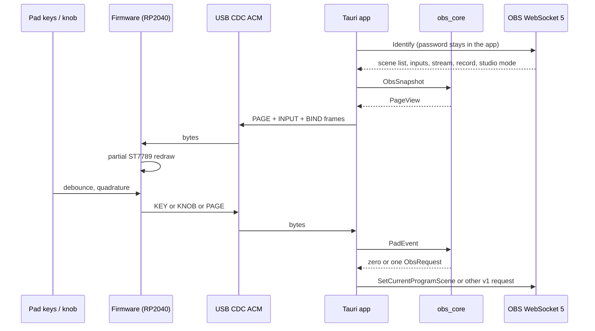

# macropad-obs: OBS control macropad

> **This is the v1 design, kept as history.** The v2 spec is `docs/spec/spec-v2.md`. Task 1.1
> deleted the Pico SDK build this file describes (`firmware/src/`, `firmware/CMakeLists.txt`,
> `firmware/Dockerfile`, `just firmware`). Task 1.2 moved `firmware/link.*` and `firmware/input.*`
> to `firmware/core/` and `host/src/` to `host/obs_core/src/`. Paths and recipes below are v1 names.

| | |
|---|---|
| Author | TBD |
| Date | 2026-11-15 |
| Status | Draft |
| Repo | `/home/worxbend/Projects/macropad-obs` (not created by this document) |
| GitHub | `w0rxbend/macropad-obs` (public, fresh history, not a fork) |
| Donor | `/home/worxbend/Projects/macropad-greycode` (read only; patterns, not history) |

## Overview

macropad-obs is a bus-powered USB device that drives OBS Studio from nine MX keys, one EC11 knob, and a 2.4 inch colour TFT. The enclosure is one wedge: a single top face at 8° from the desk, front edge low, USB edge high. Keys, knob, and glass are coplanar and flush on that face. There is no overlay lens and no step down to the glass. The pad never opens a socket and never stores the OBS password. A Linux Tauri 2 application holds the obs-websocket 5 connection, translates pad events into OBS requests, and pushes scene names, levels, and stream state back down a CDC link for the display.

The mechanical and electrical source of truth is `board.toml`, the same rule as greycode. Firmware pin headers and the host USB identity are checked against it. The wire format lives in one document, and the C parser and the Rust parser are tested against one vector file. KiCad, Gerbers, and case exports are generated. Unmeasured sizes stay marked `MEASURE`. Nothing in this document has been built.

## Background and motivation

greycode (`/home/worxbend/Projects/macropad-greycode`) is a 3 x 3 + EC11 + 1.3 inch SH1106 pad. Its host link is a 32-byte VIA raw-HID report (`docs/protocol.md`, `firmware/greycode/hostlink.c`, `host/src/protocol.rs`). Labels are six ASCII characters. The firmware is QMK/Vial. That fits app profiles. It does not fit OBS.

OBS needs more than nine scene names, a live program-scene highlight, input names, mute, a dB value, and REC/LIVE. A 128 x 64 panel cannot show that set at a readable size. Vial and the host share one HID interface, which is why greyd goes quiet while Vial is focused. This product has no keymap editor on the pad, so that sharing is wasted complexity. QMK also does not know what OBS is doing.

The pad is a new design. Fresh git history. Do not import greycode commits. Copy the engineering bar, not the board outline:

- `board.toml` is the pin and mechanical source of truth. `tools/check_pins.py` binds firmware and host to it.
- A protocol change updates the C parser, the Rust parser, `firmware/test/vectors.txt`, and `docs/protocol.md` in one change.
- `pcb/kicad/`, `pcb/fab/`, and case STEP/STL are generated. Hand edits get overwritten.
- `MEASURE` stays on any size that is not from a datasheet or a caliper.
- Never weaken a check or a test to get green. Add a check for what you add.
- Status numbers in `README.md` come from command output, in the same change.

## Goals and non-goals

### Goals

- v1 controls OBS Studio over obs-websocket 5 from Linux: scenes, paging, key remap, profiles, input mute, knob volume in dB, stream state, record state, studio-mode transition.
- Key event to OBS request issued in under 50 ms on localhost. A display update finishes in under 100 ms after the snapshot is known. Those budgets stay separate.
- `just test` is green on a machine with gcc, cargo, and Python 3, and with no Docker, no KiCad, no build123d, no webkit2gtk, and no hardware.
- PCBWay turnkey files: Gerbers, drill, CPL, BOM. Unverified LCSC cells say `UNVERIFIED`.

### Non-goals

- Filters, projectors, output settings, T-bar, scene-item transforms.
- macOS, Windows, a phone app, a background daemon separate from the Tauri process.
- HID keyboard reports. The pad does not type.
- Wi-Fi, Bluetooth, or any radio.
- Touch.
- QMK, Vial, or a key matrix.
- Per-key or edge addressable LEDs.
- Flashing the pad from the app. UF2 via the RP2040 ROM only.
- A second OBS connection, or more than one pad.

## Proposed design

### System



The Tauri process is the only host process. Closing it drops OBS and the pad keeps the last labels, then marks the link dead after three missed heartbeats. The pad cannot reach OBS by itself.

### Repository layout

End state. Pull requests below say which PR creates each tree.

```text
board.toml
justfile
README.md
CLAUDE.md
LICENSE
LICENSE.cern-ohl-s
docs/protocol.md
docs/obs.md
firmware/
  link.c              pure C parser, no SDK headers
  link.h
  pins.h              GPIO macros, checked against board.toml
  st7789.c            command builder, writes to a byte sink
  st7789.h
  font8x16.c          ASCII 8x16 bitmap
  input.c             debounce, quadrature, push timing, backlight gate. No SDK headers
  input.h
  src/                pico-sdk CDC task, SPI, bootsel. Calls input.c. Not in just test
  test/vectors.txt
  test/test_link.c
  test/test_st7789.c
  test/test_input.c
  Dockerfile          pico-sdk image for just firmware
host/                 crate obs_core
  Cargo.toml
  src/lib.rs
  src/config.rs
  src/keymap.rs
  src/paging.rs
  src/volume.rs
  src/profile.rs
  src/protocol.rs
  src/bridge.rs       Bridge<P: Port>, no serialport, no websocket
  src/obs.rs          ObsSnapshot, ObsRequest, no I/O
app/
  src-tauri/          binary macropad-obs, Tauri 2
  ui/                 HTML/JS, no bundler
pcb/gen/              pure Python generator and unit tests
pcb/kicad/            generated
pcb/fab/              generated Gerber, drill, BOM, CPL
cad/                  build123d, new model
cad/exports/          generated
tools/check_pins.py
```

`just test` at the end of the series runs only native checks:

| Recipe | What | Absent tool |
|---|---|---|
| `test-firmware` | `gcc -fsanitize=address,undefined -Werror` on `link.c`, `st7789.c`, `input.c`, and their tests | fail |
| `test-host` | `cargo test` in `host/`, then clippy `-D warnings`, then `cargo fmt --check`. Includes the bridge and the password redaction test | fail |
| `check` | `python3 tools/check_pins.py` | fail |
| `pcb-test` | `python3 -m unittest` in `pcb/gen`. No KiCad import | fail |
| `cad-check` | if `cad/.venv/bin/python` exists, run the geometry checks; if not, print `cad check skipped: no cad/.venv` and exit 0 | skip, exit 0 |

`just pcb` and `just firmware` are Docker recipes. They are not dependencies of `just test`. `just firmware` builds a UF2. `just pcb` runs the generator inside `kicad/kicad:9.0.9` the same way greycode's `pcb/Makefile` does. Both may be unavailable. Their absence is not a test failure.

`just app` builds `app/src-tauri`. It is not part of `just test`. Tauri 2 pulls in `wry`, and that crate's build script needs `webkit2gtk-4.1`. The donor configurator already fails there (`configurator/README.md`: `src-tauri/` stops in `javascriptcore-rs-sys`). A missing WebKit fails `just app` and must not fail `just test`. The README says so, and it does not claim the window launched.

### Controls and pins

Nine MX keys, one GPIO each, active low, internal pull-up. No matrix and no diodes. One Alps EC11 with push. Encoder A, B, and the push use the same internal pull-ups. Scene pages on the TFT cover scene lists longer than nine. This matches the locked control set.

Two frames. The PCB frame is what `board.toml` `[pcb]` and the KiCad generator use: origin at the PCB front-left corner, +x to the right, +y toward the USB edge, millimetres along the board. The board is flat in that frame. The glass outline in that frame is the true 42.72 x 60.26 mm. Do not multiply it by `cos(8°)`. The desk frame is what the case uses: z = 0 is the flat underside of the base, feet excluded, and the whole top face (and the PCB, which is parallel to it) sits at `face_tilt_deg` from that plane.

```toml
[board]
name = "macropad-obs"
mcu = "RP2040"
flash = "W25Q128JVSIQ"          # 16 MB, SOIC-8 208 mil, LCSC C97521
usb = { vid = 0x1209, pid = 0x4F42 }  # pid.codes; not submitted yet, see Risks

[keys]
gpio = [2, 3, 4, 5, 6, 7, 8, 9, 10]   # row by row, back row first, left to right
pitch_mm = 19.05
switch = "MX, hot-swap socket, Kailh CPG151101S11 class"

[knob]
part = "Alps EC11E18244AU"
gpio_a = 12
gpio_b = 13
gpio_push = 11
pulses_per_detent = 4           # MEASURE: some EC11 variants give 2

[display]
part = "Raystar RFJ240M-ALW-DNN"
driver = "ST7789V"
interface = "4-wire SPI"
logic_v = 3.3
outline_mm = [42.72, 60.26, 2.25]   # datasheet typ; thickness ±0.1
active_mm = [36.72, 48.96]
resolution = [240, 320]
fpc_edge = "near"               # MEASURE on a sample: design assumes FPC exits the near edge
fpc_pins = 20
fpc_pitch_mm = 0.5
gpio_sck = 18                   # SPI0 SCK, panel pin 8 DCX(SCL)
gpio_mosi = 19                  # SPI0 TX, panel pin 7 SDA
gpio_cs = 17                    # SPI0 CSn, panel pin 9 CSX, active low
gpio_dc = 20                    # panel pin 10 WRX(D/CX)
gpio_reset = 21                 # panel pin 6 RESET, active low
gpio_bl = 22                    # backlight FET gate, external pulldown, default off

[boot]
gpio_run = "RUN"                # RESET tact, not a GPIO number
qspi_ss = "QSPI_SS"             # BOOT tact through 1 k, as in Hardware design with RP2040
```

`firmware/pins.h` is the firmware side of the contract. It is C macros only, so `tools/check_pins.py` can read it with a regex the way greycode's checker reads `config.h`. The checker also reads `host/src/protocol.rs` for `USB_VID` and `USB_PID`. A mismatch exits 1. The checker does not open KiCad.

SPI0 pin choice is the RP2040 hardware SPI0 set (SCK GP18, TX GP19, CSn GP17). DC, RESET, and BL are ordinary GPIO. Keys and the encoder stay on GP2-GP13, the same numbers as greycode, so the QFN-56 can keep the key side toward the front of the board. GP0 and GP1 are UART0 test pads for bring-up and are not referenced by `pins.h`. The release UF2 compiles that UART out.

### Electrical

RP2040, W25Q128JVSIQ on the dedicated QSPI pins, 12 MHz crystal. USB-C device. 5.1 kΩ from CC1 to GND and from CC2 to GND. No CC controller. The pad is not a USB host and has no radio.

Power path, same topology as `pcb/gen/circuit.py` in greycode:

1. USB-C VBUS through a 500 mA hold polyfuse (nSMD050 class) to net `V5`.
2. `AP2112K-3.3` from `V5` to `V3`. 2.2 µF on the 5 V side, 10 µF on the 3.3 V side.
3. `USBLC6-2SC6` on D+ and D-. 27 Ω series resistors close to RP2040 USB pins.
4. Crystal circuit from *Hardware design with RP2040*: Abracon ABM8-272-T3, 12 MHz, 15 pF load capacitors, 1 kΩ from XOUT to the crystal. The MPN is the donor's. Its LCSC cell is `UNVERIFIED`.
5. Decoupling, same guide: 100 nF on each IOVDD, DVDD, USB_VDD, and ADC_AVDD pin, and 1 µF on VREG_VIN and on VREG_VOUT.
6. BOOT: `TS-1187A` from the BOOT net to GND, and 1 kΩ from BOOT to `QSPI_SS`. Hold BOOT while plugging in. The ROM enumerates as `RPI-RP2`.
7. RESET: `TS-1187A` from `RUN` to GND. `RUN` uses the RP2040 internal pull-up. Double-tap within 500 ms enters the ROM bootloader. The SDK file sets `PICO_BOOTSEL_VIA_DOUBLE_RESET=1` and `PICO_BOOTSEL_VIA_DOUBLE_RESET_TIMEOUT_MS=500` (the SDK default is 200 ms; without the second define the window is wrong). The README flash section names both defines. `PICO_STDIO_USB` is off. We own the USB device.
8. Blank flash, with no button, also enumerates as `RPI-RP2`. That is ROM behaviour when the second stage is missing. Both tact switches are bottom-side SMT and line up with holes in the case floor.

Backlight, from the Raystar electrical table (cited below): LED current typical 80 mA, `VLED+` 2.8 V min, 3.1 V typ, 3.3 V max, one LED group. Driving that at 80 mA from a USB device that may only draw 100 mA before configuration is the wrong default.

Design point: **39.5 mA worst-case ceiling, 30.6 mA at 5.00 V and Vf 3.1 V.**

- `V5` to `VLED+` through 62 Ω, 1206, 1%. USB VBUS is 4.75 V to 5.25 V. Worst case is `(5.25 - 2.8) / 62 = 39.5 mA`. At 5.00 V and Vf 3.1 V the current is `(5.00 - 3.1) / 62 = 30.6 mA`. A 56 Ω part is 43.8 mA at 5.25 V and Vf 2.8 V, so it is not a 40 mA ceiling.
- `VLED-` goes to the drain of an N-channel MOSFET, source at GND, SOT-23. The part must state Rds(on) at Vgs = 2.5 V and an Id of at least 200 mA. A 2N7002 does not: its Rds(on) is specified at 4.5 V or 5 V, and Vgs(th) max can be 3.0 V, so a 3.3 V GPIO can leave it linear. Gate is GP22 with 100 kΩ to GND, so the backlight is off at reset and while the USB device is unconfigured. LCSC cell `UNVERIFIED`. Do not invent a C-number.
- Firmware turns GP22 on only after the USB configuration is set. There is no PWM in v1. Firmware cannot raise the current. The resistor sets the ceiling.
- Datasheet brightness at 80 mA is 500 cd/m². This design runs near 31 mA typical. Do not quote a nit number. It has not been measured.
- Panel logic current is 6.4 mA typical, 9.6 mA max, on 3.3 V. It does not go through the 62 Ω resistor.

Operating budget after configuration. These are design ceilings, not measurements:

| Consumer | Rail | Design ceiling |
|---|---|---|
| RP2040 running from flash, USB up | 3.3 V | 40 mA |
| W25Q128 read bursts | 3.3 V | 15 mA |
| ST7789 logic | 3.3 V | 10 mA |
| Backlight | 5 V | 39.5 mA worst, 30.6 mA at 5.00 V and Vf 3.1 V |
| Sum | | 105 mA worst |

The device requests 250 mA (`bMaxPower` = 125, units of 2 mA). The polyfuse hold current stays 500 mA so a fault does not become a fire, and so the number is not tight against the 105 mA budget. Before configuration the target is under 80 mA: backlight FET off, panel held in reset.

No SK6812MINI-E and no side-emitting LEDs. Nine reverse-mount LEDs would fit under the sockets physically. They are out of v1 anyway. greycode's own open point is that 15 of those LEDs can draw about 0.9 A, above the polyfuse. This product's only red accent is pixels on the TFT (`#ff3b30` for REC). The perimeter shell split is a dark reveal, not a light pipe. Adding a lamp would spend the USB budget the backlight already shares.

### Display and FPC

Verified panel: Raystar **RFJ240M-ALW-DNN**.

- Product page: <https://www.raystar-optronics.com/ger/2.4-2.8-tft-lcd-display-module/st7789-tft-display.html>
- Datasheet PDF linked from that page: <https://www.raystar-optronics.com/upload_files/tft-lcd-display-module/2-4-tft/tft-panel/RFJ240M-ALW-DNN-datasheet.pdf>
- Outline 42.72 ± 0.2 by 60.26 ± 0.2 by 2.25 ± 0.1 mm. Plan max is 42.92 x 60.46 mm. Thickness max is 2.35 mm. The brief's 2.30 mm thickness sits inside the thickness tolerance. The pocket is cut to the plan max plus 0.30 mm clearance, 43.22 x 60.76 mm, and to 2.35 mm deep, so a legal panel fits and the thickest glass is flush with the key plate. A typical 2.25 mm glass sits 0.10 mm low. There is no overlay lens. A lens on top of the glass would put the TFT below the plate.
- Active area 36.72 x 48.96 mm. Pixel pitch 0.153 mm. 240 x RGB x 320. Portrait. No touch. ST7789V. SPI. View direction 6 o'clock, which is the near edge, the side the user looks from.
- Logic 2.4 V to 3.6 V, typical 3.3 V.
- No LCSC C-number was found for this MPN. The BOM cell is `UNVERIFIED`. The brief names Polcd P024C115 as the same outline class. This design did not fetch a Polcd page, so that MPN is not an approved second source.

FPC, from the same pin table and contour notes (`P0.5 x 19 = 9.50 mm`, contact thickness 0.30 ± 0.05 mm). The brief's 12-circuit connector is the right family and the wrong circuit count. The panel brings out 20 circuits. That falsifies 12. Use Hirose **FH12-20S-0.5SH(55)**: 20 position, 0.5 mm, bottom contact, right angle, ZIF, 2.0 mm above the board, FPC thickness 0.30 mm.

- LCSC **C596730**, fetched 2026-11-15 from <https://item.szlcsc.com/625321.html> and <https://www.lcsc.com/product-image/C596730.html>.
- The 12-circuit part FH12-12S-0.5SH(55) is a different SKU (LCSC C88360). Do not load it.

Panel pin to net:

| Pin | Symbol | Net |
|---|---|---|
| 1 | GND | GND |
| 2 | VLED+ | BL_A, after the 62 Ω |
| 3 | VLED- | BL_K, MOSFET drain |
| 4 | GND | GND |
| 5 | VCC | V3 |
| 6 | RESET | GPIO21, active low |
| 7 | SDA | SPI0 TX |
| 8 | DCX(SCL) | SPI0 SCK. On this panel the serial clock is this pin |
| 9 | CSX | GPIO17, active low |
| 10 | WRX(D/CX) | GPIO20. D/C in 4-line mode |
| 11 | GND | GND |
| 12 | SDO | open. Firmware does not read the panel |
| 13 | TE | open |
| 14 | IM3 | GND through a 0 Ω resistor (R20), so the strap can move |
| 15 | GND | GND |
| 16-19 | NC | open |
| 20 | GND | GND |

IM3 low selects 4-line 8-bit serial, SDA in/out, with the module's on-glass IM2/IM1/IM0 straps (the pin table lists mode `0 1 1 0`). R20 is the rework if a sample is strapped the other way. 4-wire SPI here means SCK, MOSI, CS, and D/C, plus RESET. It does not mean the FPC has four conductors.

SPI clock is 20 MHz, mode 0. Pixel bytes are RGB565, high byte first. A full 240 x 320 frame is 153600 bytes, 61.4 ms at 20 MHz (`153600 * 8 / 20e6`). v1 does not send that on a page change. `CASET` / `RASET` / `RAMWR` limit the write to dirty rectangles. The v1 worst case is one dirty cell block plus the status row and the input row: `(216 + 28 + 36) * 240 * 2 = 134400` bytes, 53.8 ms at 20 MHz. That SPI time sits inside the display budget. The display budget is 100 ms after the snapshot is known. It is not the key-to-OBS budget, and it does not include the 50 ms host coalesce.

Font is a built-in 8 x 16 ASCII bitmap, `0x20` through `0x7E`, 1520 bytes. No framebuffer library and no external font file. The driver keeps no full frame buffer. It keeps the last text of each region and skips a region whose text, colour, and flags did not change.

Glass layout, portrait, origin at the visual top-left (far from the user, left). `MADCTL` is `0x00` until a real panel says otherwise. That constant is `MEASURE`. The host byte-trace test cannot see the glass, so it does not pick the bits. `test_st7789.c` asserts the init bytes below, the two delay constants, and the glyph counts in the layout. Correct `MADCTL` on the first panel by changing the one constant.

Init, in order: `SWRESET` (`0x01`), delay 120 ms, `SLPOUT` (`0x11`), delay 120 ms, `COLMOD` (`0x3A`) with argument `0x55` (16-bit), `MADCTL` (`0x36`) with argument `0x00`, `NORON` (`0x13`), `DISPON` (`0x29`), delay 20 ms. A Sitronix ST7789 stays blank if the 120 ms delays are skipped.

```text
y 0
+----------------------------------------+  240 px wide
| host:port (21 glyphs) RECLIVE       |  status, 28 px. one space before R. no space in RECLIVE
| profile name                           |  20 px
| rule                                   |  2 px
|  cell0     cell1     cell2             |
|  cell3     cell4     cell5             |  3 x 3, cell 80 x 72 = 216 px
|  cell6     cell7     cell8             |
| rule                                   |  2 px
| input name              -12 dB     M   |  36 px
| page 2/8                               |  16 px
+----------------------------------------+
y 319
```

28 + 20 + 2 + 216 + 2 + 36 + 16 = 320. A cell is 80 px, so one line holds 10 glyphs. The wire name is still at most 16 bytes. The renderer draws two lines of at most 10 glyphs and does not draw a 17th byte. Sixteen bytes are line 1 (10) and line 2 (6). The status row draws at most 21 glyphs of `host:port` (168 px), then one space (8 px), then `REC` (24 px) and `LIVE` (32 px) with no gap between those two words. `168 + 8 + 24 + 32 = 232` px, inside the 240 px row. The last 8 px are unused. The drawing shows `RECLIVE`. A longer host:port keeps 20 glyphs and a trailing `.` so the field stays 21. `docs/protocol.md` states this next to `PAGE_VIEW` and `BIND`. `test_st7789.c` asserts 21 host glyphs.

Colours are design values: background `#1c1c1e`, text `#f5f5f7`, program cell fill `#3a3a3c` with a 2 px `#f5f5f7` border, REC `#ff3b30` and only while recording, LIVE `#ff9f0a` while streaming, muted `M` in `#ff9f0a`, empty cell text `#636366`. No red on the metal.

`fpc_edge = "near"` means the FPC leaves the glass edge closer to the user. The FH12 centre is `(44.0, 73.5)` on the PCB top, on the display centreline, between the back key row (`y = 62.00`) and the glass near edge (`y = 82.0`). The Hirose courtyard is `MEASURE` until that drawing is applied to the footprint. The contract uses the footprint courtyard, not a guessed body size. The connector is under the plate web. It is not in the glass pocket. If a sample has the FPC on the far edge, `board.toml` moves the connector toward the USB edge and the case slot follows. That is a placement change, not a new architecture.

### Case

New build123d model. Do not scale `cad/greycode_case/`. The donor case is a flat 66 x 96 mm plate. This case is a wedge. One top face. The nine keys, the knob, and the glass are coplanar on that face. The glass is the window. There is no overlay lens, no second surface, no step down to the glass, and no angle between the glass and the key plate.

The whole top face is 8.0° from the desk, inside the 6–10° range. The front edge (near the user) is the low edge. The back edge (USB side) is the high edge. The PCB is parallel to the top face, so key stems and the display normal are perpendicular to the PCB. The base bottom is flat on the desk. Rise is the along-face depth times `sin(8°)`, not the glass height times `sin(8°)`.

PCB outline, design values in `board.toml` `[pcb]`, in the PCB frame (change them only in a change that rebuilds `pcb/` and `cad/`):

| Key | Value | Note |
|---|---|---|
| `width` | 88.0 | knob on the right of the key grid |
| `depth` | 150.0 | along the board, not the desk projection |
| `thickness` | 1.6 | |
| `corner_radius` | 2.0 | |
| `layers` | 4 | signal / GND / power / signal |
| `key_x` | 20.00, 39.05, 58.10 | pitch 19.05 |
| `key_y` | 62.00, 42.95, 23.90 | row 0 is the back row, along the board |
| `knob` | 79.6, 42.95 | middle row. 21.5 mm from the right key |
| `display_origin` | 22.64, 82.0 | glass left x, near y. Centred on x = 44 |
| `display_size` | 42.72, 60.26 | full outline on the face. Not foreshortened |
| `fpc` | 44.0, 73.5 | FH12 centre, top side |
| `boot` | 12.0, 8.0 | tact, bottom side |
| `reset` | 76.0, 8.0 | tact, bottom side |
| `holes` | (8.0, 18.0), (80.0, 18.0), (8.0, 108.0), (80.0, 108.0) | M2, diameter 2.2, keep-out diameter 5.0 (radius 2.5) |
| `usb_x` | 44.0 | centred |
| `usb_face` | `bottom` | mouth past the back edge |
| `usb_mouth_overhang` | 0.5 | |
| `usb_centre_from_pcb` | 1.6 | along the face normal, below the PCB bottom face |

Glass on the face: left x = 22.64, right x = 65.36, near y = 82.0, far y = 82.0 + 60.26 = 142.26. The PCB back edge is y = 150, so 7.74 mm of board sits behind the glass. That remainder holds the USB receptacle. KiCad stays flat. The case applies the 8° wedge only when it places that flat PCB into the desk frame.

Knob and keys. The knob is 22 mm diameter. The keycap guess is 18 mm (`KEYCAP.base` in the donor `cad/greycode_case/spec.py`). Centres are 79.6 − 58.10 = 21.5 mm apart. The keycap rule needs 20 mm, so the plan gap is 1.5 mm. The switch-housing guess is 15.6 mm, so half-housing 7.8 + knob radius 11 = 18.8 mm, and the plan gap is 2.7 mm. PCB x = 0 sits at case x = 3.6. The knob centre is at case x = 83.2. The knob's right edge is at 94.2, which is 1.0 mm inside the 95.2 mm outer width. All three of those sizes that come from the donor case file stay `MEASURE`.

MX sockets are rotation 0 degrees. At that rotation the front-left socket courtyard's left edge is x = 12.8. The hole at (8.0, 18.0) is 4.8 mm from that edge. The contract fails if a keep-out circle of radius 2.5 mm intersects a socket, the encoder, the glass, the FH12, or a tact. Radius 2.5 mm clears that edge by 2.3 mm. The keep-out value in `board.toml` is `hole_keepout_diameter = 5.0`. It is not a radius. Centre-to-centre distance is not the clearance check.

```toml
[case]
face_tilt_deg = 8.0            # whole top face from the desk, front low, back high
material = "6061-T6, bead blast, anodised"
wall = 3.2
pcb_clearance = 0.4
corner_radius = 10.0
face_front_z = 12.0            # desk frame: top face at the front outer edge
floor = 2.4                    # base floor thickness
plate_above_pcb = 5.0         # normal distance, PCB top to the top face. MX clip height. Do not raise it for the encoder
plate_web = 1.5
shadow_gap = 0.8               # perimeter reveal at the shell joint only
pocket_plan = [43.22, 60.76]   # outline max 42.92 x 60.46 plus 0.30 mm
pocket_depth = 2.35            # datasheet thickness max. No overlay lens
bushing_hole = 7.4             # MEASURE
encoder_pocket = [12.4, 12.4]  # MEASURE. Open through the plate
knob_diameter = 22.0
knob_lift = 1.8                # MEASURE. Underside is 0.3 mm above the 6.5 mm body
keycap = 18.0                  # MEASURE
switch_housing = 15.6          # MEASURE
```

Derived, not a second source of truth. `grow = wall + pcb_clearance = 3.6`. Along-face outline is 95.2 x 157.2 mm. Rise = `157.2 * sin(8°) = 21.88 mm`. Back edge of the top face is at z = 12.0 + 21.88 = 33.88 mm. Desk footprint depth is `157.2 * cos(8°) = 155.67 mm`. That cosine is the base on the desk. It is not the glass size.

Shell:

- Material 6061-T6, bead blast, anodised graphite. No paint. No red anodise.
- Two shells. The show joint is the underside of the 1.5 mm plate, parallel to the top face. The bay is open from the floor up to that plate. A ceiling on the PCB top plane fills the MX gap and puts the M2 threads in base metal. The PCB is the clamp plane: bosses below it, standoffs above it. The cut is not horizontal.
- Screws only from below, axis on the face normal, 8° from vertical. Four ISO 10642 M2×10 screws, one length. The head seat is 7 mm below the PCB top, so the tip stops 3 mm into the standoff and 2 mm under the key plane. A head on the outer skin cannot share that length: the front mouth is about 10 mm from the PCB top and the back mouth is about 23 mm. A 5 mm access bore runs from the desk up to the seat, inside an 8 mm boss root. The neck that meets the PCB is 4.6 mm diameter. The top standoffs are 4.0 mm diameter, tap drill 1.6 mm by 3.5 mm plus the drill point. Both fit in the 5.0 mm keep-out. No fastener shows on the top face.
- Outer wall 3.2 mm, PCB-to-wall clearance 0.4 mm. The show outline is a quintic Bezier of the 95.2 by 157.2 mm box, not `corner_radius`. On each side of each corner the control points sit 10.935, then 6.561, then 2.187 mm from the corner. Curvature is zero where the curve meets the straight. Smallest radius is 5.16 mm. `corner_radius` stays 10.0 and is not the outline. The 0.8 mm shadow gap is a second B-spline of that same family on the inset box, not an offset of the outer curve.
- Two 45° chamfers. The top outer edge, in the face frame, is 0.8 mm. The base underside, in the desk frame, is 1.7 mm, so the base recedes. That cut stays inside the 2.4 mm floor and below the USB mouth at z 25.26. The rear wall stays vertical above it. The 0.8 mm lip stays sharp. No 0.3 mm seam chamfer. Each long side has one finger scoop, 56 mm long, radius 6 mm, 1.0 mm past the shadow-gap wall, centred 9 mm off the desk. Both knob rims are 0.5 mm.
- One top face. Integrated MX plate, 1.5 mm web, plate top 5.0 mm above the PCB top, measured normal to the PCB. That 5.0 mm is the MX clip height. Do not raise it to bury the encoder. Switch cut-out 14.0 mm. Dogbone radius 1.5 mm where the tool reach is over 3 mm. Those cutter rules are the donor's, and they stay. Keycaps stand proud of the dish floor, along the face normal.
- One dish. The 1.5 mm web stays the floor on the current face plane, so `plate_above_pcb` stays 5.0 at the keys. A 3.0 mm border is added along the face normal, then one pocket is subtracted with 45° walls. The floor is one sharp rectangle, not a fillet: x 14.95 to 70.35, y 18.85 to 147.61. Keys and the glass stay on that floor. The rim stays parallel to the floor, so it is still 8° from the desk. The right rim stops at x 73.35. The border is not raised inside the 22 mm knob circle. There is no 3.5 mm dish.
- The glass drops into a pocket in that dish floor. Pocket plan 43.22 x 60.76 mm. Pocket depth 2.35 mm, parallel to the floor, so a datasheet-max panel is flush with the key plate. A typical 2.25 mm panel sits 0.10 mm low. There is no smoked lens, no acrylic, and no ledge that holds a second sheet. The active area is cut 0.6 mm into the glass. The black slab sits in that pocket. The part-outline check stays on 42.72 x 60.26 mm, so a cosine-shrunk window still fails.
- Encoder pocket. The donor body guess is 12.0 x 12.0 x 6.5 mm. A 3.5 mm cavity under a 5.0 mm plate cannot hold that body, and a metal ceiling at 6.8 mm would lift this face off the key plate. The pocket is open through the plate: 12.4 x 12.4 mm (0.2 mm side clearance on each side), with a 7.4 mm bushing hole in that opening. The body sticks out 1.5 mm past the face. The 0.3 mm top clearance is to the knob underside, not to metal. `knob_lift = 1.8` mm puts the underside 0.3 mm above the body top. Around that hole, one well is cut from the top of the 1.2 mm lip, radius 11.9 mm, depth 0.7 mm, floor at z 0.5, centred at case (83.2, 46.55). Left edge x 71.3, right edge x 95.1. The cutter runs 0.2 mm above z 1.2. The lip used to be 3 mm, which put the flush glass at the bottom of a tray. Each key has a 0.45 mm reveal, 18.5 mm across, so the cap sits in a shadow line. The cap dish is a spherical pocket 3.0 mm deep, radius 8.5 mm, with a rim. The well is a 23.8 mm shallow well, a 0.9 mm ring around the 11 mm knob. Radius 12.2 meets the nearest cap. There is no collar. The 22 mm knob covers the opening (half-diagonal 8.77 mm, knob radius 11 mm). Body, bushing, side clearance, top clearance, and knob lift are `MEASURE`.
- Perimeter shadow gap: 0.8 mm reveal where the top shell meets the base, all the way around. The 0.8 mm lip stays sharp. No step between the keys and the glass. No LED in the gap.
- Dial, 22 mm diameter, graphite, axis along the face normal, foot at `knob_lift` 1.8. The shaft end is 24.5 mm above the PCB (EC11E18244AU drawing No. 2, MEASURE) and the cap keeps 2 mm of metal above it. Two plain 1.6 mm bands and one square-ended band of 36 straight flutes, 0.7 mm deep and 1.3 mm wide. An index 1.2 mm wide breaks the top rim on the flat side (+y). An M3 radial hole, 3 mm, sits 5.5 mm below the top and opens onto that flat. The bore is round, then a D over the flat, with 0.2 mm clearance. A 8 mm pocket clears the 7 mm bushing. The proud body stays visible in the well. New solid, not a copy of the donor mesh.
- USB-C on the rear, case closed. Receptacle on the PCB bottom, mouth 0.5 mm past y = 150. The plug axis is the PCB's +y, so it rises 8° from the desk. The rear wall is vertical. The opening is cut along the plug axis so the plug does not bind. Outside that 14 by 7 mm tunnel, an 18 by 9.2 mm lead-in runs 2.2 mm deep. It stays below the plate. A point at along-face distance `s` from the front outer edge, `n` mm inward along the face normal from the top face, is at `z = 12.0 + s*sin(8°) - n*cos(8°)`. PCB top is `s = 3.6 + y` and `n = 5.0`. PCB bottom is `n = 6.6`. The USB mouth centre is 1.6 mm further in, so `y = 150`, `n = 8.2`, `z = 25.26` mm. That centre is inside the 33.88 mm back face and clear of the glass.
- Front is the tight end. PCB underside at y = 0 is `n = 6.6`, `s = 3.6`, `z = 5.97`, which is 3.57 mm above the 2.4 mm floor. A 2.0 mm tact body (MEASURE, TS-1187A) at PCB y = 8 is `n = 8.6`, `z = 5.10`, which is 2.70 mm above the floor. Front-row sockets clear by more, because they sit further up the wedge.
- BOOT and RESET holes in the floor, 4.0 mm diameter, axis along the button normal (the face normal, not vertical). They line up with the bottom-side tacts at `(12.0, 8.0)` and `(76.0, 8.0)`. A paperclip must reach the actuator with the case closed. Actuator position relative to the hole is `MEASURE` against the TS-1187A drawing when the footprint is drawn. The four M2 holes are a different set.
- Four silicone feet on the flat base. Diameter and pocket depth are `MEASURE`.

EC11 body 12.0 x 12.0 x 6.5 mm, bushing hole 7.4 mm, side clearance 0.2 mm, top clearance 0.3 mm to the knob underside, keycap 18 mm, switch housing 15.6 mm, and the USB plug overmold stay `MEASURE`, with the donor's numbers as the starting guess and the tag left on. Do not delete the tag because a guess was copied. `knob_lift` is 1.8 mm so that 0.3 mm gap is the designed gap, not a metal ceiling.

`cad/build.py check` imports the model and checks:

- The top face is 8.0° ± 0.05° from the base bottom (the desk).
- The display window and the key plate are coplanar: the angle between their normals is 0 within 0.05°. There is no check that the glass by itself is at 8°.
- On the 2.35 mm glass model, the TFT top plane and the key-plate plane coincide within 0.05 mm. The typical 0.10 mm offset of a 2.25 mm panel is not this check.
- The window outline on the face is 42.72 x 60.26 mm from `board.toml`. A cosine-foreshortened window fails this check. The pocket plan is 43.22 x 60.76 mm and is not that outline check.
- The 22 mm knob circle does not intersect an 18 mm keycap or a 15.6 mm switch housing. The encoder body does not intersect the plate outside the 12.4 mm pocket.
- The show joint is the plate underside, and the bay is open up to it. USB mouth is on the rear and not covered by a shell wall. Both floor holes exist and their axes match the button normals. No screw breaks the top face. Each M2 keeps at least 2 mm of thread and 1 mm of metal under the key plane. The 4.6 mm neck and the 4.0 mm standoff stay inside the 5 mm keep-out. Foot pockets clear the access bores. Screws, the USB jack, the encoder, and the MX housings do not occupy shell metal. The only shadow gap is the perimeter joint. There is no lens solid.

If `cad/.venv` is missing, the script prints the skip line and exits 0. `just test` depends on that exit code.

### Firmware

Custom C, pico-sdk, not QMK. The USB device is one CDC ACM interface. TinyUSB comes with the SDK. `PICO_STDIO_USB=0`. The parser does not include TinyUSB or `pico.h`.

`firmware/link.c` owns framing. The SDK file `firmware/src/usb.c` pulls bytes with `tud_cdc_available` / `tud_cdc_read` and pushes them into `link_feed`. That split is the same rule as greycode's `hostlink.c`: the parser tests under ASan on the host. A DTR rise (`tud_cdc_line_state_cb`, 0 to 1) calls `link_session_reset`. Until `HELLO_ACK`, `link_feed` drops every host frame except `HELLO_ACK`. `usb.c` is not in `just test`. The reset rule is.

`firmware/st7789.c` builds the init sequence from the display section into a caller-provided buffer: `SWRESET` (`0x01`), delay 120 ms, `SLPOUT` (`0x11`), delay 120 ms, `COLMOD` (`0x3A`, argument `0x55`), `MADCTL` (`0x36`, argument `0x00`), `NORON` (`0x13`), `DISPON` (`0x29`), delay 20 ms, then `CASET`, `RASET`, `RAMWR`, and RGB565 pixels, high byte first. `test_st7789.c` asserts those command bytes, both delay constants, 21 host glyphs, a one-character draw, and a skipped redraw when the text is unchanged. No panel, no SPI hardware. `MADCTL` stays `0x00` until a real panel. The test does not invent it.

`firmware/input.c` is pure C next to `link.c`. It has no SDK headers. `test_input.c` feeds a fake 1 ms tick and a fake USB-configuration flag. Key debounce is 10 ms. Quadrature emits one detent per `pulses_per_detent` edges (4 until someone measures). Knob push under 400 ms emits `PAGE +1` on release. Knob push of 400 ms or more emits `PAGE -1` on release. Rotation emits `KNOB` with a saturated `int8` detent count. Key down and key up both emit `KEY`. The backlight gate stays 0 until the configuration flag is true. `firmware/src` only samples GPIO and calls `input.c`. Those product rules are on `just test`.

The pad does not decide what a key means. It does not store scene names except the last text the host sent. It does not store a password field, and `link.h` has no API that accepts one.

Boot paths:

| State | What the user does | What enumerates |
|---|---|---|
| Blank flash | Plug in | ROM, `RPI-RP2` |
| Firmware running | Hold BOOT, plug in | ROM, `RPI-RP2` |
| Firmware running | Double-tap RESET, 500 ms window | ROM, `RPI-RP2` |
| Firmware running | Plug in, no button | CDC ACM, then the app |

`just firmware` runs `firmware/Dockerfile` (Ubuntu 24.04, pico-sdk pinned by commit in the Dockerfile) and copies `firmware/dist/macropad-obs.uf2`. It is not part of `just test`.

### Protocol

One document: `docs/protocol.md`. Version 1. Transport is USB CDC ACM, not HID. CDC is the pick because a failing board can be watched with a serial program, and because this pad never sends keyboard reports. HID would repeat greycode's 32-byte report and its Vial collision for no product gain. Baud in the ACM line coding is ignored. The link runs at USB full speed.

Byte order is little-endian. Text is printable ASCII (`0x20`-`0x7E`); any other byte is stored as `?`.

```text
0        SOF          0xA5
1        version      0x01
2        type         u8
3..4     length       u16, payload bytes, 0..240
5..      payload      `length` bytes
end-2    crc          CRC-16/MODBUS, low byte first
```

CRC-16/MODBUS: reflected poly `0xA001`, init `0xFFFF`, xorout `0x0000`, over version through the end of the payload. Not over SOF. Check value: ASCII `123456789` → `0x4B37`.

A good frame for `KEY` index 3 down, CRC `0x82B8`:

```text
a5 01 02 02 00 03 01 b8 82
```

That line is in `firmware/test/vectors.txt`. The parser resyncs by scanning for `0xA5`. Length above 240, a bad version, or a bad CRC drops the frame and advances one byte. Unknown type with a good CRC is dropped and counted. The link does not reset.


Pad to host:

| Type | Name | Payload |
|---|---|---|
| `0x01` | HELLO | `u8 proto`, `u8 keys=9`, `u16 features` (0 in v1) |
| `0x02` | KEY | `u8 index 0..8`, `u8 down` (1 pressed, 0 released) |
| `0x03` | KNOB | `i8 detents` saturated, sent when the count is non-zero |
| `0x04` | PAGE | `i8 delta` (`+1` short push, `-1` long push) |

Host to pad:

| Type | Name | Payload |
|---|---|---|
| `0x10` | HELLO_ACK | `u8 proto` |
| `0x11` | HEARTBEAT | empty. Host sends one every 1 s |
| `0x12` | BIND | `u8 state`, `u16 port`, `u8 host_len`, host bytes (1..48). State: 0 down, 1 connecting, 2 auth failed, 3 connected, 4 connected non-loopback. No password, no path, no userinfo |
| `0x13` | PROFILE | `u8 len`, name bytes, 1..24 |
| `0x14` | PAGE_VIEW | `u8 page`, `u8 page_count`, `u8 flags`, then 9 times (`u8 slot_flags`, `u8 len`, 0..16 name bytes). Flags bit0 studio mode, bit1 streaming, bit2 recording. Slot bit0 occupied, bit1 this slot is the program scene |
| `0x15` | INPUT | `i8 db` (-100..26), `u8 muted`, `u8 len`, name bytes 0..24 |
| `0x16` | NOTICE | `u8 len`, text 0..32. The pad shows it for 1 s in the status bar, then restores BIND |

A session starts at USB configuration and again on every DTR rise. The pad drops the acked flag and sends HELLO within 100 ms, then every 1 s until `HELLO_ACK`. Until that ACK, it ignores every host frame except `HELLO_ACK`. A second ACK after the flag is set is an ordinary frame, not a new session. The shell asserts DTR on open, waits up to 2 s for HELLO, sends `HELLO_ACK`, then starts the 1 s heartbeat. On websocket close the shell sends BIND state 0. Three missed heartbeats (3 s) set the status bar to `NO LINK` and keep the last page text. The pad does not invent OBS requests. `vectors.txt` has a line for bytes after a session reset and before ACK: a `PAGE_VIEW` is rejected.

`PAGE_VIEW` name bytes are at most 16. The glass draws them as two lines of at most 10 glyphs and does not draw a 17th byte. `BIND` host bytes are at most 48. The status row draws at most 21 glyphs of `host:port` (168 px), then one space (8 px), then `REC` and `LIVE` adjacent (`RECLIVE`, 56 px). `168 + 8 + 24 + 32 = 232`. A longer host:port keeps 20 glyphs and a trailing `.`. `docs/protocol.md` states both rules next to the frames.

There is no frame whose schema can carry a secret. `protocol.rs` and `link.c` tests include a BIND payload and assert the encoded bytes contain only the host, the port, and the state.

### Host core

Crate `obs_core` in `host/`. No Tauri, no `serialport`, no Tokio, no websocket crate. `cargo test` is the proof.

Public surface, stable once PR 2 merges:

```rust
pub fn parse(text: &str) -> Result<Config, ConfigError>;
pub fn load(path: &Path) -> Result<Config, ConfigError>;
pub fn save(path: &Path, config: &Config) -> Result<(), ConfigError>;
pub fn connect_target(config: &Config, addrs: &[SocketAddr]) -> Result<SocketAddr, ConfigError>;
pub fn round_db(raw: f64) -> i8;

pub struct Core { /* private */ }
impl Core {
    pub fn new(config: Config) -> Self;
    pub fn apply_snapshot(&mut self, snap: ObsSnapshot);
    pub fn on_pad(&mut self, event: PadEvent) -> Vec<Effect>;
    pub fn poll(&mut self, now_ms: u64) -> Vec<Effect>;
    pub fn page_view(&self) -> PageView;
    pub fn select_input(&mut self, name: &str) -> Result<(), CoreError>;
    pub fn set_key(&mut self, index: u8, action: KeyAction) -> Result<(), CoreError>;
}
```

`Effect` is either `Obs(ObsRequest)` or `Notice(String)`. The shell performs I/O. The core returns data.

`ObsRequest` variants, and the obs-websocket 5 methods the shell must call:

| Request | OBS method |
|---|---|
| `SetProgramScene { name }` | `SetCurrentProgramScene` |
| `SetProfile { name }` | `SetCurrentProfile` |
| `SetMute { name, muted }` | `SetInputMute` |
| `SetVolumeDb { name, db }` | `SetInputVolume` with `inputVolumeDb` |
| `StartStream` / `StopStream` | `StartStream` / `StopStream` |
| `StartRecord` / `StopRecord` | `StartRecord` / `StopRecord` |
| `Transition` | `TriggerStudioModeTransition` |

`SetInputVolume` accepts `inputVolumeDb` in `-100..=26` (obs-websocket 5.4.2 protocol). The core clamps to that range and steps by 1 dB. It never sends `inputVolumeMul`. `round_db` rounds a float to nearest, half away from 0, before the `i8` frame and before a step. `0.5` becomes `1`. `-0.5` becomes `-1`. The shell calls it on every `GetInputVolume` and `InputVolumeChanged` before `apply_snapshot`.

`ObsSnapshot` carries the scene list (max 64, order preserved from OBS), the current program scene, the profile name, the profile list (max 32), the input list (max 32, name, muted, volume dB), stream on, record on, and studio mode on. Above the cap, the core keeps the prefix and `page_view` sets a notice the shell can show once. That cap is a decision, not a later option.

Key actions in the config, closed set:

| `action` | Behaviour |
|---|---|
| `scene` | Press sends `SetProgramScene` for the scene in that slot on the current page. Key up does nothing |
| `mute` | Toggles mute on the selected input only. dB is unchanged. There is no per-key input field |
| `transition` | If `studio_mode` is true, emit `Transition`. If false, emit `Notice("studio off")` and no OBS request |
| `stream` | `StopStream` if the snapshot says streaming, else `StartStream` |
| `record` | same for record |
| `profile_next` / `profile_prev` | wrap in the snapshot profile list |

Scene keys are the only slots that page. Fixed actions stay on that key on every page, and the label in `PAGE_VIEW` is the action name (`Mute`, `Trans`, `Live`, `Rec`, `Prof+`, `Prof-`). A name longer than 16 bytes is cut to 15 bytes plus a trailing `.` before it enters the frame. The glass wraps those 16 bytes onto two lines of at most 10 glyphs.

Page size is the number of `scene` keys. The default of nine scene keys gives page size 9. `set_key` and `parse` return `ConfigError` if the scene-key count would become 0. Page index wraps. `PAGE +1` / `-1` from the pad changes the index and changes `page_view`. It does not talk to OBS. Empty slots emit nothing.

Knob detents call `SetVolumeDb` on the selected input. Selection comes from `select_input`, which the UI calls. If nothing is selected, the core selects the first input that survived the volume read. If that list is empty, a detent returns no effect. One detent is 1 dB. The first detent returns `SetVolumeDb` at once and starts a 30 ms window. Further detents add to a pending dB value. `poll(now_ms)` emits one clamped request when the window ends. `apply_snapshot` does not move the pending dB. PR 2 tests `poll` with an injected `now_ms`. It does not sleep.

Latency budget, localhost, design targets:

| Step | Budget |
|---|---|
| Key debounce | 10 ms |
| CDC frame, full speed, under 32 bytes | 5 ms |
| App parse and `Core::on_pad` | 5 ms |
| Websocket request issued | 20 ms |
| Sum, key to OBS request | 40 ms, limit 50 ms |
| Display update after the snapshot is known | frame handling plus 134400 bytes, 53.8 ms SPI at 20 MHz. Limit 100 ms. The 50 ms host coalesce is not in this row |

`bridge::Bridge<P: Port>` reads bytes, emits `PadEvent`s, and writes the frames for `PageView`, `BIND`, `PROFILE`, `INPUT`, and `NOTICE`. `Port` is `read` and `write` on byte slices. Tests use a `Vec` port. This module has no file descriptor.

Config path: `$XDG_CONFIG_HOME/macropad-obs/config.toml`, or `~/.config/macropad-obs/config.toml`. Directory mode `0700`. File mode `0600`. `parse` does not check the mode. `parse` allows only `ws://` and `wss://`, rejects userinfo, and rejects `allow_non_loopback = true` unless the URL is `wss://`. `load(path)` is the only read path the shell uses. It creates the directory at `0700` if missing. It refuses if the directory or the file has any `0o077` bit (`ConfigError::Perms`). A missing file, after the directory check, is `ConfigError::Missing`. `save` creates the directory at `0700` if missing, writes the temp file at `0600`, `fsync`s, then renames.

```toml
[obs]
url = "ws://127.0.0.1:4455"
password = "replace-me"
allow_non_loopback = false

[[key]]
action = "scene"
# eight more scene keys, then optional fixed actions replace a scene key
```

`password` is a `Secret` newtype. Its `Debug` and `Display` are `"***"`. `parse` denies unknown fields.

Non-loopback default is false. The checkbox only writes the file through `save`. A hand-edited TOML can set the flag too. The shell resolves the host once and passes that list to `connect_target`. It connects to the returned sockaddr. It does not resolve again. If the flag is false, every address must be `127.0.0.0/8` or `::1`, and an IPv4-mapped address is rejected, including `::ffff:127.0.0.1`. The name `localhost` is allowed only when that one resolve passes. If the flag is true, `parse` has already required `wss://`, and `connect_target` returns the first sockaddr from that same list. The pad's `BIND` frame still gets host and port only.

### App shell

`app/src-tauri` is the Tauri 2 binary `macropad-obs`. It depends on `obs_core` and on the `obws` crate for obs-websocket 5. The exact `obws` version is whatever current 5.x-compatible release PR 3 locks in `Cargo.lock`. The core does not depend on it.

The shell maps `ObsRequest` onto `obws` calls. On connect it reads, in order: `GetSceneList`, `GetCurrentProgramScene`, `GetProfileList`, `GetCurrentProfile`, `GetStreamStatus`, `GetRecordStatus`, `GetStudioModeEnabled`, `GetInputList`, then `GetInputMute` and `GetInputVolume` for each input. An input whose `GetInputVolume` fails is dropped. The cap of 32 applies after that drop. The default selected input is the first input that remains. `GetInputList` does not carry mute or dB. Those come only from the per-input calls.

Stream and record are on only when `outputState` is `OBS_WEBSOCKET_OUTPUT_STARTED` or `OBS_WEBSOCKET_OUTPUT_RECONNECTED`. `STARTING`, `STOPPING`, `STOPPED`, `RECONNECTING`, `PAUSED`, and `RESUMED` are off. The shell reads `outputState` from `GetStreamStatus`, `GetRecordStatus`, `StreamStateChanged`, and `RecordStateChanged`. It does not treat `outputActive` as the on bit.

Events that update the snapshot: `CurrentProgramSceneChanged`, `SceneListChanged`, `InputMuteStateChanged`, `InputVolumeChanged`, `StreamStateChanged`, `RecordStateChanged`, `CurrentProfileChanged`, `StudioModeStateChanged`, `InputCreated`, `InputRemoved`, `InputNameChanged`. After `CurrentProfileChanged` the shell repeats the scene reads and the input reads. Event bursts coalesce for 50 ms, then one `PAGE_VIEW` and one `INPUT` go out. That 50 ms is host-side. It is not part of the 100 ms display budget. Once the snapshot is known, the display update finishes in under 100 ms. Do not add 50 ms and 53.8 ms into one path.

CDC open path: the shell sets DTR, waits up to 2 s for HELLO, sends `HELLO_ACK`, then the 1 s heartbeat. The device node is `/dev/macropad-obs`, from `app/udev/70-macropad-obs.rules`:

```text
SUBSYSTEM=="tty", ATTRS{idVendor}=="1209", ATTRS{idProduct}=="4f42", TAG+="uaccess", SYMLINK+="macropad-obs"
```

The README installs it with:

```text
sudo cp app/udev/70-macropad-obs.rules /etc/udev/rules.d/
sudo udevadm control --reload
sudo udevadm trigger
```

There is no `plugdev` group and no `MODE` assignment. Seat access comes from `TAG+="uaccess"`, the same form as the donor `host/udev/70-greycode.rules`.

`serialport` lives only in the shell. The type that implements `Port` is tested with a fake in `host`. The bridge test checks that a BIND encoder output does not contain the password string from a sample config. That test is `cargo test` in `host/`.

UI, `app/ui/`, plain HTML and JS, no Node build. Tauri commands:

- `get_state` → connection state, scenes, inputs, profile, the 3 x 3 map, last key-to-request milliseconds
- `set_connection` → url, password, `allow_non_loopback`
- `set_key` → index and action
- `select_input`
- `set_profile`
- `connect` / `disconnect`

Screens: connection form (URL, password, the non-loopback checkbox labelled "Allow OBS on another machine"), scene list, input list with mute and dB, 3 x 3 keymap grid, profile picker. Password field is `type=password`. The command result never echoes it.

`just test` does not cargo-build `app/src-tauri`. `just app` does. A missing `webkit2gtk-4.1` fails `just app` and must not fail `just test`. `README.md` says the window needs that package. Do not claim the window launched. `just test` does not invoke `tauri dev`.

### PCB and order files

`pcb/gen/` is pure Python, the same split as greycode (`circuit.py` for parts and nets, `contract.py` for the `board.toml` checks, `fab.py` for BOM and CPL). Unit tests build the in-memory netlist and the BOM rows. They do not import KiCad. `just pcb` is the Docker KiCad 9.0.9 step that writes `pcb/kicad/` and `pcb/fab/`.

Board is 4 layers, 1.6 mm, and it is a two-sided SMT job. RP2040 and the small passives are on the bottom. The FH12 is on the top. The EC11 is through-hole and hand soldered. The two tacts are bottom-side SMT. The CPL `Layer` column says `top` or `bottom`. Do not describe the order as one-sided. F.Cu and B.Cu are signal, In1 is ground, In2 is power. Decoupling is the set in the electrical section: 100 nF on each IOVDD, DVDD, USB_VDD, and ADC_AVDD, and 1 µF on VREG_VIN and VREG_VOUT. The crystal sits close to XIN/XOUT. The USB resistors sit close to the MCU. Design-rule tests, not loosened after the fact:

- USB D+ and D- length mismatch ≤ 1.0 mm from receptacle to MCU.
- Each QSPI net ≤ 15 mm, including `QSPI_SS` out to the 1 kΩ BOOT resistor.
- XIN and XOUT ≤ 10 mm.

greycode's `pcb/README.md` records two length checks that were loosened after routing (USB mismatch to 3.0 mm, a 27 Ω stub to 8 mm). This design does not copy those limits. If the router misses, the layout moves. The check stays.

SMT BOM columns, PCBWay / JLCPCB: `Comment`, `Designator`, `Footprint`, `LCSC Part #`, `Manufacturer`, `Manufacturer Part`. A cell that was not fetched in this design or in the donor's dated check is the text `UNVERIFIED`.

CPL columns: `Designator`, `Mid X`, `Mid Y`, `Layer`, `Rotation`. Y sign follows the generator's documented origin and the test locks it. Bottom-side rotation is written as KiCad's rotation and called out as unverified against PCBWay's preview, the same open point greycode has. Do not "fix" it by guessing a 180° flip.

Hand sheet `pcb/fab/hand.csv`, same header as the SMT BOM plus `Note`. These rows are not hidden and are not in the pick-and-place file:

| Comment | Why |
|---|---|
| Alps EC11E18244AU | through-hole, hand soldered. Donor `pcb/README.md` names LCSC C202365. This design did not re-fetch that page, so the cell is `UNVERIFIED` |
| Raystar RFJ240M-ALW-DNN | turnkey-sourced glass, not a machine-placed part. LCSC `UNVERIFIED`. FPC is part of the glass |

SMT lines. Locked means the donor README dated 2026-11-15 names the C-number, or this design fetched the page. Anything else in the table is `UNVERIFIED`:

| Comment | LCSC | Manufacturer part | Source |
|---|---|---|---|
| RP2040 | C2040 | RP2040 | locked; donor README checked 2026-11-15 |
| W25Q128JVSIQ | C97521 | W25Q128JVSIQ | locked; donor README |
| USB-C | C165948 | HRO TYPE-C-31-M-12 | `UNVERIFIED`. Present in greycode `pcb/gen/circuit.py`. Not re-fetched 2026-11-15 |
| AP2112K-3.3 | C51118 | AP2112K-3.3TRG1 | `UNVERIFIED`. Present in `circuit.py`. Not re-fetched 2026-11-15 |
| USBLC6-2SC6 | C7519 | USBLC6-2SC6 | `UNVERIFIED`. Present in `circuit.py`. Not re-fetched 2026-11-15 |
| TS-1187A | C318884 | TS-1187A-B-A-B | `UNVERIFIED`. Present in `circuit.py`. Not re-fetched 2026-11-15. BOOT and RESET |
| FH12-20S-0.5SH(55) | C596730 | FH12-20S-0.5SH(55) | fetched this design |

Passives, the polyfuse, the crystal (Abracon ABM8-272-T3), the backlight MOSFET, the 0 Ω IM3 strap, and the MX sockets are `UNVERIFIED`. The MOSFET comment is `N-channel, Rds(on) at Vgs=2.5 V, Id ≥ 200 mA, SOT-23`. It is not a 2N7002. The socket comment is `MX hot-swap, Kailh CPG151101S11 class`. Do not copy greycode's HanElectricity substitution (`C49352235`) into this BOM. The donor README says that pad match is a guess. The flash comment is `W25Q128JVSIQ, SOIC-8 208 mil`.

Gerbers: F.Cu, B.Cu, In1.Cu, In2.Cu, F.Mask, B.Mask, F.Paste, B.Paste, F.Silk, B.Silk, Edge.Cuts, PTH drill, NPTH drill. Zip in `pcb/fab/`. `just pcb` hashes the netlist into `board-sha256.txt` after the Docker run. `pcb-test` does not read that file and does not require it. A clean tree with no Docker still passes `pcb-test`. `pcb-test` without KiCad checks the row builder, the net names, and the `board.toml` placement contract: outline, `key_x`, `key_y`, knob, `display_origin`, `display_size`, FH12 centre and top side, both tact centres and bottom side, the four holes with diameter 2.2 and keep-out diameter 5.0 (radius 2.5), MX socket rotation 0, nine sockets, encoder pads, FPC pin count 20, USB-C, no SK6812 footprint. A keep-out circle of radius 2.5 mm that hits a socket, the encoder, the glass, the FH12, or a tact fails the test.

### Data model

No database. One TOML file, mode `0600`, plus RAM in the app process.

`Config` is the file. `ObsSnapshot` is the last OBS view, not written to disk. `Core` holds the page index and the selected input name in RAM. Restart loses the page index (back to 0) and keeps the keymap, the URL, and the password. Scene names are not cached on disk in v1. A restart with OBS down shows an empty page and `BIND` state down.

Migration: there is no previous file format. `parse` denies unknown fields so a future key does not load halfway. A format change bumps a `version` key and rejects other versions. v1 files have no `version` key; adding one is a later format, not this one.

### API and interface changes

There is no old API. The new stable surfaces are:

- `obs_core::parse`, `load`, `save`, `connect_target`, `round_db`, `Core` (including `poll`), `ObsRequest`, `PadEvent`, `PageView`.
- `docs/protocol.md` frame types listed above.
- Tauri commands listed above.
- `board.toml` keys listed above.
- udev symlink `/dev/macropad-obs`.

The app does not expose a TCP port of its own. OBS is the only socket, and it is outbound.

## Alternatives considered

### QMK plus a host plugin

Rejected. QMK/Vial is the donor firmware and it is the wrong owner for this product. Scene names and dB values change under OBS, not under a keyboard layer. The donor already had to pause the host link whenever Vial was focused, because they share raw HID. A QMK build also pulls the vial-qmk tree (the donor pins a commit and a Docker image) for a device that must not be a keyboard. Custom firmware is smaller: a CDC task, a parser that already tests on the host, and an SPI command builder.

### Wi-Fi on the pad

Rejected. The locked decision is no radio. A pad-side OBS client would store the password on the device, which this design forbids. Pairing, DHCP, and a second network path add failure modes the USB cable does not have. Localhost websocket latency is the 50 ms budget. Wi-Fi would spend that budget before the key debounce finished.

### 0.96 inch or 1.3 inch OLED

Rejected. The donor's SH1106 path (`OLED_DISPLAY_128X64`, six-character labels in `docs/protocol.md`) cannot show nine scene names, a profile, a host, REC/LIVE, and a dB reading. That is the reason this product exists as a separate repo.

### 2.8 inch and larger

Rejected. A 2.8 inch class module is on the order of 50 x 70 mm. This case already spends 60.26 mm of along-face depth on the 2.4 inch glass, in front of which the key field sits. A 70 mm glass pushes the along-face depth past about 170 mm, and the wedge rise grows with that whole face. That is a laptop-trackpad plan, not a hand pad. 2.4 inch is the largest outline in the locked decision, and it is a panel PCBWay can be asked to source.

### Touch

Rejected. The locked decision is no touch. A touch controller adds a second interface on the FPC, a second connector or a wider one, and palm hits on a pad that already has nine keys. Keys select scenes. The knob changes dB and page.

### HID instead of CDC

Rejected for v1. HID matches the donor and is worse here. There is no keyboard usage, report descriptors are harder to debug on a bench with no hardware, and a serial terminal can speak CDC. The framing is still ours (length, version, CRC), so CDC packet boundaries are not frame boundaries.

### Direct GPIO versus a matrix

Rejected a matrix. Nine keys plus three encoder pins fit in the RP2040 GPIO map with SPI left over. Diodes would be extra BOM lines for a problem this board does not have. The locked decision already forbids a 15-key deck and a matrix.

## Security and privacy

| Threat | Mitigation |
|---|---|
| OBS password reaches the pad | No frame type has a secret field. Tests on both parsers use a sample password and assert it is absent from every encoded frame. Firmware has no password API |
| Password in logs | `Secret` debug is `***`. Shell tests fail if a log line from a connection attempt contains the sample password. URL userinfo is rejected by `parse` |
| Password in the git tree | `config.example.toml` uses `replace-me`. Real file is under XDG, mode `0600`. `load` refuses group or world access |
| OBS bound to another machine by mistake | Default URL `ws://127.0.0.1:4455`. Non-loopback requires `wss://` and the flag. The shell connects to the sockaddr from one resolve. IPv4-mapped addresses do not count as loopback |
| Malicious CDC host | The pad only accepts the frame types above. A bad CRC is dropped. The pad cannot send USB HID keystrokes, so a confused app cannot type through it |
| Unrequested firmware update | The app has no flash path. UF2 is a manual copy to `RPI-RP2` |
| Radio sniffing | No radio is fitted. The schematic test fails if a wireless module footprint is present |

The websocket stays on the machine. Auth is obs-websocket 5's challenge (the `obws` crate). The password is read from the config file at connect time and held in the shell's memory. It is not written into `BIND`, not written into a crash string, and not shown in the UI after save. The connection form loads an empty password field and a "password is set" flag.

## Observability

No metrics server. One machine, one user.

- App log: `$XDG_STATE_HOME/macropad-obs/app.log`, or `~/.local/state/macropad-obs/app.log`. Rotate at 1 MB, keep 3 files.
- Info lines: connect, disconnect, auth failure (no password), scene change, stream on/off, record on/off, CRC error counts every tenth error.
- The UI status line shows the last key-to-request time in milliseconds, measured from CDC `KEY` down to the `obws` call returning that the request was written. Target under 50 ms. This is a display, not an alert pager.
- Firmware UART0 on GP0/GP1 is compile-time off in the release UF2. Bring-up builds may enable it. Those strings stay on the test pads, not on CDC, so they cannot mix with frames.
- The pad shows `NO LINK`, `AUTH`, or the host:port from `BIND`. That is the field diagnostic.

## Rollout

No feature flag service. The rollout is the five pull requests, then a hardware spin.

1. Merge PR 1 through PR 5 with `just test` green on each.
2. `just firmware` and `just pcb` when Docker is available. Do not treat a missing Docker daemon as a product failure.
3. First PCB order uses the generated BOM. Cells that say `UNVERIFIED` get a real LCSC number in a follow-up change before that line is sent to PCBWay, or the part is consigned and stays on `hand.csv`.
4. First boot is the ROM drive, then the UF2, then CDC. OBS can be down. The pad must show `NO LINK` and still page locally through an empty list without faulting. Restarting the app, with the pad still enumerated, asserts DTR. The pad sends HELLO within 100 ms. A replug is not required.
5. Rollback of software is the previous UF2 and the previous app binary. `board.toml` and the protocol version move together. A v1 app refuses a pad HELLO with `proto != 1`. There is no mixed-version mode.

The pid.codes submission for `1209:4F42` happens before any public UF2 is attached to a release. Until that submission is recorded in the README, the status line says the PID is not registered.

## Risks

| ID | Severity | Risk | Mitigation |
|---|---|---|---|
| R1 | High | FPC leaves the far edge of the glass, not the near edge. `fpc_edge` is `MEASURE` | One `board.toml` move of the connector. Case slot follows. Not a protocol change |
| R2 | High | Strict USB ports drop a device that exceeds 100 mA before configuration | Backlight FET off until configured. 62 Ω gives 39.5 mA worst case at 5.25 V and Vf 2.8 V. Budget under 80 mA before configuration. First board gets a current measurement; the tag stays until then |
| R3 | Medium | 30.6 mA typical is dimmer than the datasheet 500 cd/m² in a bright room | Accept for v1. Do not lower the 62 Ω resistor without revisiting `bMaxPower` |
| R4 | Medium | PCBWay cannot source Raystar RFJ240M-ALW-DNN. LCSC cell is `UNVERIFIED` | Glass is a sourced line on `hand.csv` and can be consigned. Do not swap in a different outline without a `board.toml` change |
| R5 | Medium | `1209:4F42` collides because pid.codes was not submitted | README status stays "not registered" until the submission is recorded. No second product shares the PID |
| R6 | Medium | Bottom-side CPL rotation is wrong at the assembler | Same residual as greycode. Preview at PCBWay before paying. Do not guess a rotation offset in the generator |
| R7 | Medium | IM3 on a given lot is not the 4-line strap the pin table describes | R20 is a 0 Ω to GND and can move to 3.3 V. USB still enumerates either way |
| R8 | Low | More than 64 scenes or 32 inputs | Core keeps the prefix and the UI says the list was truncated |
| R9 | Low | `pulses_per_detent` is 2 on the fitted EC11 | `MEASURE`. One number in `board.toml`, pin check covers it |
| R10 | Low | webkit2gtk-4.1 is not installed | The window crate is outside `just test`. `just app` is allowed to fail. README states the window dependency. Do not fake a window launch |
| R11 | Medium | Router cannot meet the 1.0 mm USB match or the 15 mm QSPI cap | Move parts. Do not copy greycode's loosened limits |
| R12 | Low | The front of the wedge is the tight end. `face_front_z = 12.0` leaves 2.70 mm under a 2.0 mm tact body at y = 8, and that body is `MEASURE` | If the body is taller than that clearance, raise `face_front_z` only. Do not tilt the glass off the key plate |

## Open questions

None. The choices that were still free after the locked decisions are recorded under Key Decisions. R1 through R12 are risks, not questions.

## Key decisions

1. **CDC ACM, not HID.** The pad is not a keyboard. CDC can be watched with a serial tool. Framing is length, version, and CRC-16/MODBUS on top of the byte stream.
2. **20-circuit FH12, not 12.** Raystar RFJ240M-ALW-DNN brings out 20 pins at 0.5 mm. FH12-20S-0.5SH(55), LCSC C596730. The 12-circuit part is the wrong SKU. Source: Raystar pin table, fetched 2026-11-15.
3. **Backlight worst case 39.5 mA, typical 30.6 mA at 5.00 V and Vf 3.1 V, FET off until USB is configured.** The resistor is 62 Ω, 1206, 1%. Worst case is `(5.25 - 2.8) / 62`. The FET is an N-channel part with Rds(on) stated at Vgs = 2.5 V and Id at least 200 mA. It is not a 2N7002. LCSC stays `UNVERIFIED`. Datasheet typical is 80 mA. A bus-powered device that has not been configured should stay under 100 mA. The request after configuration is 250 mA.
4. **No SK6812, no side LEDs.** The red accent is the REC text `#ff3b30` on the TFT. Addressable LEDs do not fit the USB budget. The perimeter shell split is not a lamp.
5. **Custom pico-sdk firmware, not QMK.** OBS state is host-owned. The parser stays free of SDK headers so `just test` does not need the SDK.
6. **One Tauri process, no daemon.** The app owns the websocket. `obs_core` does no I/O. The bridge is generic over a `Port`.
7. **Password only in the XDG file, mode `0600`.** `load` is the only shell read path. It creates the directory at `0700` and refuses any `0o077` bit on the directory or the file. `save` writes the temp file at `0600`, fsyncs, then renames. `Secret` does not debug-print. Non-loopback requires `wss://` and a sockaddr from one resolve. The checkbox only writes the file. Default host is `127.0.0.1`.
8. **Fixed key actions are a closed set.** `scene`, `mute`, `transition`, `stream`, `record`, `profile_next`, `profile_prev`. Mute uses the selected input only. Transition does not call OBS when studio mode is off. It sends a one-second notice instead.
9. **Volume step is 1 dB, clamp -100 to +26, `SetInputVolume` with `inputVolumeDb` only.** The first detent returns at once. `Core::poll(now_ms)` emits one summed request when the 30 ms window ends. Knob push pages. Rotation never pages.
10. **Scene cap 64, input cap 32, label 16 ASCII bytes.** Page size is the count of scene keys, default 9, and it cannot be 0. `round_db` is nearest, half away from 0.
11. **VID `0x1209`, PID `0x4F42`.** Not the donor's test PID `0x0001`. Not registered until the README says so.
12. **4-layer PCB, USB length match ≤ 1.0 mm, QSPI ≤ 15 mm.** Do not import the donor's loosened length checks. M2 keep-out is diameter 5.0 mm, which is radius 2.5 mm. MX socket rotation is 0 degrees. The contract fails if that radius-2.5 mm circle hits a socket, the encoder, the glass, the FH12, or a tact.
13. **Display glass and the EC11 are hand / sourced lines, listed on `hand.csv`.** SMT BOM is machine-placed parts only. Unverified LCSC cells are the string `UNVERIFIED`.
14. **`fpc_edge = "near"` and a flush glass pocket.** Outline is 42.72 ± 0.2 by 60.26 ± 0.2 by 2.25 ± 0.1 mm. Pocket plan is 43.22 x 60.76 mm. Pocket depth is 2.35 mm, so the thickest glass is flush with the key plate. There is no overlay lens. FPC centre is `(44.0, 73.5)` on the top side. FPC edge stays `MEASURE`.
15. **The case is a wedge.** The glass is not at an angle to the keys. Keys and the glass are flush on one dish floor, and `plate_above_pcb` stays 5.0 mm there. `face_tilt_deg = 8.0` lives on `[case]`, not on `[display]`. Front edge low, USB edge high. PCB parallel to that face. Rise is `157.2 * sin(8°) = 21.88 mm`. The show outline is a quintic Bezier of the 95.2 by 157.2 mm box, not `corner_radius` (that value stays 10.0). On each side of each corner the control points sit 10.935, then 6.561, then 2.187 mm from the corner. Curvature is zero at the straights. Smallest radius is 5.16 mm. The 0.8 mm shadow gap is the same Bezier family on the inset box, not an offset. Glass on the face is the full 42.72 x 60.26 mm, origin `(22.64, 82.0)`, in a pocket 43.22 x 60.76 x 2.35 mm, flush, no lens. The dish is a 3.0 mm border along the face normal with 45° walls. Its floor is the rectangle x 14.95 to 70.35, y 18.85 to 147.61. The right rim stops at x 73.35. The rim stays parallel to the floor at 8°. The border is not raised inside the 22 mm knob circle. Knob is `(79.6, 42.95)`, 21.5 mm from the right key at x = 58.10. The encoder pocket is 12.4 mm through the plate. The dial is 22 mm by 16 mm on the face normal, foot at `knob_lift` 1.8, two plain 1.6 mm bands, 36 straight flutes, 0.7 mm deep and 1.3 mm wide, and an index 1.2 mm wide that breaks the top rim on the flat side. The bore is a D on the EC11 shaft, with an M3 hole onto the flat. It stands in a 22 mm well 0.7 mm below the plate, centred at case (83.2, 46.55), with no collar. Two 45° chamfers: 0.8 mm on the top outer edge, 1.7 mm on the base underside only. Each long side has a 1.0 mm finger scoop. The USB mouth has an 18 by 9.2 mm lead-in, 2.2 mm deep. The 0.8 mm lip stays sharp. No seam chamfer. Screws from below. BOOT and RESET holes in the floor. USB mouth centre is z = 25.26 mm. No paint.
16. **Licenses.** `LICENSE` is MIT for `firmware/`, `host/`, `app/`, and `tools/`. `LICENSE.cern-ohl-s` is CERN-OHL-S-2.0 for `pcb/` and `cad/`. The README says which tree each file covers. Hardware sources are not MIT. The donor has no license, which is why this repo does not vendor its files.
17. **`just test` does not build `app/src-tauri`, does not import KiCad, and does not import the SDK.** It skips the CAD geometry check only when `cad/.venv` is missing. `just app` is allowed to fail without webkit2gtk-4.1. `board-sha256.txt` is written by `just pcb` only.
18. **`obws` in the shell only.** Core tests must not link it.

## References

- Donor bar: `/home/worxbend/Projects/macropad-greycode/CLAUDE.md`, `board.toml`, `docs/protocol.md`, `tools/check_pins.py`, `justfile`, `pcb/gen/circuit.py`, `pcb/README.md` (order files and the loosened length checks), `cad/greycode_case/spec.py`, `firmware/greycode/config.h`, `firmware/greycode/keymaps/vial/keymap.c`.
- Raystar RFJ240M-ALW-DNN pin table, outline, and LED drive (80 mA typ, VLED 2.8/3.1/3.3 V, ICC 6.4/9.6 mA): <https://www.raystar-optronics.com/ger/2.4-2.8-tft-lcd-display-module/st7789-tft-display.html> and the PDF linked there.
- Hirose FH12-20S-0.5SH(55), LCSC C596730: <https://item.szlcsc.com/625321.html>, <https://www.lcsc.com/product-image/C596730.html>.
- obs-websocket 5.4.2, `SetInputVolume` dB range and `TriggerStudioModeTransition`: <https://github.com/obsproject/obs-websocket/blob/5.4.2/docs/generated/protocol.md>.
- RP2040 power, crystal, and BOOTSEL: Raspberry Pi, *Hardware design with RP2040* (the donor cites it for the 12 MHz / 15 pF / 1 kΩ circuit and the 1 kΩ BOOTSEL resistor).
- CRC-16/MODBUS check value `0x4B37` for `123456789`.

## PR Plan

Five pull requests. Each one builds on the previous and stays green under the command in its description. No PR needs a pad, a Docker daemon, or KiCad to merge. `just pcb` and `just firmware` are allowed to be absent.

### PR 1 — Repo skeleton, pins, and the framed link

- **Title:** Add the repo skeleton, board.toml, and the shared CDC frame codec
- **Depends on:** none
- **Files:** `README.md`, `CLAUDE.md`, `LICENSE`, `LICENSE.cern-ohl-s`, `justfile`, `board.toml`, `docs/protocol.md`, `firmware/link.c`, `firmware/link.h`, `firmware/pins.h`, `firmware/test/vectors.txt`, `firmware/test/test_link.c`, `host/Cargo.toml`, `host/src/lib.rs`, `host/src/protocol.rs`, `tools/check_pins.py`, `app/udev/70-macropad-obs.rules`
- **Changes:** Fresh tree. `board.toml` holds the pins, the USB ids, and the mechanical numbers from this document, including `key_x`, the knob, `display_origin`, the FH12 centre, both tacts, and the four holes. `docs/protocol.md` is the frame table, the CRC, the BIND-has-no-secret rule, the glyph counts, and the session rule. `vectors.txt` includes the `KEY` frame `a5 01 02 02 00 03 01 b8 82`, a BIND frame, and a `PAGE_VIEW` rejected after session reset and before `HELLO_ACK`. `link.c` and `protocol.rs` both parse and emit those vectors. `check_pins.py` compares `pins.h` and the Rust USB constants to `board.toml`. The udev rule is `TAG+="uaccess"` with no `plugdev` group. README maps MIT to `firmware/`, `host/`, `app/`, and `tools/`, and CERN-OHL-S-2.0 to `pcb/` and `cad/`. README gives the `cp` and `udevadm control --reload` lines. `just test` runs `test-firmware`, `test-host`, and `check`. README status numbers come from that run. README says the window is not in this PR.
- **Proves it:** `just test`

### PR 2 — OBS core

- **Title:** Add obs_core config, keymap, paging, volume, and profile switch
- **Depends on:** PR 1
- **Files:** `host/src/config.rs`, `host/src/keymap.rs`, `host/src/paging.rs`, `host/src/volume.rs`, `host/src/profile.rs`, `host/src/obs.rs`, `host/src/lib.rs`, `host/config.example.toml`, `docs/obs.md`, tests under `host/src/` or `host/tests/`
- **Changes:** `parse`, `load`, and `save`. `load` creates the directory at `0700` and refuses `0o077`. `save` writes the temp file at `0600`, fsyncs, and renames. `Secret` debug is `***`. `parse` allows only `ws://` and `wss://`, rejects userinfo, and requires `wss://` when `allow_non_loopback` is true. `connect_target` checks the sockaddr list. Closed key-action set. Mute uses the selected input. `set_key` and `parse` reject a scene-key count of 0. `round_db` is nearest, half away from 0. `Core::poll(now_ms)` emits one clamped volume request when the 30 ms window ends. The first detent still returns immediately. Transition emits no `ObsRequest` when studio mode is false and emits a notice. Profile prev/next wrap. Caps at 64 scenes and 32 inputs. No Tauri, no socket, no serial.
- **Proves it:** `just test` (cargo tests for `load` perms, paging, a zero scene-key count, `poll` with an injected clock, `round_db`, volume clamp, studio-mode ignore, profile wrap, `connect_target`)

### PR 3 — Tauri shell and the CDC bridge

- **Title:** Add the Tauri shell, OBS client, and in-memory CDC bridge
- **Depends on:** PR 2
- **Files:** `host/src/bridge.rs`, `app/src-tauri/**`, `app/ui/**`, `app/src-tauri/Cargo.toml` (depends on `obs_core` and `obws`), `justfile` (`app` recipe, not on the `test` chain)
- **Changes:** `Bridge<P: Port>` tested against a `Vec` port inside `host/`: bytes in become `PadEvent`s, a `PageView` becomes bytes out, a sample password never appears in those bytes, and a `PAGE_VIEW` before `HELLO_ACK` is ignored. The shell opens `/dev/macropad-obs`, sets DTR, waits for HELLO, sends `HELLO_ACK`, then heartbeats. It runs the connect reads named in the app-shell section, drops inputs whose volume request fails, rounds dB with `round_db`, treats only `STARTED` and `RECONNECTED` as on, repeats scene and input reads after `CurrentProfileChanged`, and subscribes to `InputCreated`, `InputRemoved`, and `InputNameChanged`. It coalesces OBS events at 50 ms and exposes the Tauri commands. The checkbox only writes the file. UI: connection form, scene list, input list, 3 x 3 grid, profile picker. `just test` does not cargo-build `app/src-tauri`. `just app` is allowed to fail without webkit2gtk-4.1. README says that, and it does not claim the window launched.
- **Proves it:** `just test`

### PR 4 — Firmware CDC, ST7789 traces, UF2 recipe

- **Title:** Add the pad firmware, display byte traces, and the UF2 Docker recipe
- **Depends on:** PR 1 (protocol and pins). Does not need PR 3 to compile. Review it after PR 3 so the bridge and the pad share a merged frame doc.
- **Files:** `firmware/st7789.c`, `firmware/st7789.h`, `firmware/font8x16.c`, `firmware/input.c`, `firmware/input.h`, `firmware/test/test_st7789.c`, `firmware/test/test_input.c`, `firmware/src/**` (USB, SPI, bootsel; calls `input.c`), `firmware/Dockerfile`, `justfile` (`firmware` recipe, not on the `test` chain)
- **Changes:** SDK side feeds `link_feed` and transmits `link_next`. A DTR rise calls `link_session_reset`. GPIO map is `pins.h`. `input.c` owns the 10 ms debounce, one detent per `pulses_per_detent`, the 400 ms push split, and the backlight gate. `test_input.c` drives it with a fake 1 ms tick and a fake configuration flag. The gate stays low until that flag is true. `test_st7789.c` asserts `SWRESET`, both 120 ms delays, `COLMOD 0x55`, `MADCTL 0x00`, `NORON`, `DISPON`, the 20 ms delay, RGB565 high byte first, 21 host glyphs, and the skip-if-unchanged path. `REC` and `LIVE` are adjacent. The SDK file sets `PICO_BOOTSEL_VIA_DOUBLE_RESET=1` and `PICO_BOOTSEL_VIA_DOUBLE_RESET_TIMEOUT_MS=500`. The README flash section names both. `just test` still does not start Docker.
- **Proves it:** `just test`. `just firmware` is the UF2 path when Docker exists; the PR text says if it was not run.

### PR 5 — PCB generator and the wedge case

- **Title:** Add the PCB generator, PCBWay outputs, and the wedge case
- **Depends on:** PR 1 (`board.toml`). Mechanically independent of PR 2-4. Review last so the pin list is stable.
- **Files:** `pcb/gen/**`, `pcb/Makefile` or `just pcb`, `cad/**`, `justfile` (`pcb-test` always, `cad-check` with the skip, `pcb` Docker recipe not on `test`)
- **Changes:** In-memory netlist for RP2040, flash (SOIC-8 208 mil), USB-C, regulator, ESD, crystal (Abracon ABM8-272-T3), the decoupling set, nine sockets, EC11 pads, FH12 20-pin on the top, two bottom-side tacts, 62 Ω backlight resistor, and the 2.5 V-gate FET. Two-sided SMT. No SK6812. Contract test against `board.toml`: the coordinates in the case table, keep-out diameter 5.0 mm (radius 2.5 mm), MX socket rotation 0, and no `board-sha256.txt` requirement. BOM cells for C165948, C51118, C7519, and C318884 say `UNVERIFIED`. C2040 and C97521 stay locked. `hand.csv` lists the EC11 and the Raystar glass. Case is a new build123d wedge: one top face, keys, knob, and glass coplanar and flush, face 8.0° from the desk (front low, back high), PCB parallel to that face, glass outline 42.72 x 60.26 on the face, pocket 43.22 x 60.76 x 2.35 mm, no overlay lens, encoder pocket 12.4 mm through the plate, knob at (79.6, 42.95) clear of the keycaps, perimeter shadow gap only, rear USB at z = 25.26 mm, floor holes, screws from below along the face normal, knurled knob. `cad/build.py check` asserts the top face is 8.0° ± 0.05°, the window normal matches the key plate within 0.05°, and the 2.35 mm TFT top matches the key plate within 0.05 mm. It does not check the glass as its own 8° plane. It fails if the knob intersects a keycap or a switch housing. Geometry checks skip with a message when `cad/.venv` is missing. Generated `pcb/kicad/` and `cad/exports/` are produced by `just pcb` / `just cad` and are not hand-edited. Those two recipes are not required for merge if Docker or the venv is absent; the PR says which of them ran.
- **Proves it:** `just test`
